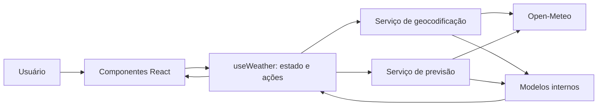

# Plano Técnico — Weather App

**Entrada:** `specs/weather-app-spec.md`
**Status:** proposta técnica derivada de uma spec ainda em rascunho. Decisões que dependem de perguntas em aberto estão identificadas como propostas ou pendências; este documento não é implementação.

## Architecture (Overview)

A aplicação será uma SPA React com separação entre interface, estado de fluxo, serviços HTTP e modelos normalizados. A interface não acessará a API diretamente: chamadas passam por serviços em `src/services/`, e a resposta externa será convertida para tipos internos antes de chegar aos componentes.



Responsabilidades propostas:

- **Interface:** coleta a busca, mostra resultados, apresenta clima atual e previsão, permite alternar a unidade e comunica loading/erro/vazio. Componentes permanecem pequenos, sem lógica HTTP.
- **Hook de fluxo:** coordena busca, seleção, consulta meteorológica, unidade e estados de interface. Cancela ou ignora requisições obsoletas quando o usuário inicia uma busca nova.
- **Serviços:** encapsulam endpoints, parâmetros, serialização, validação básica de resposta e normalização de erros.
- **Modelos e utilitários:** representam dados internos independentes do formato do provedor e concentram conversão de temperatura em uma função pura.

Rastreabilidade principal: FR-1/AC-1/AC-2 → busca e seleção; FR-2/FR-3/AC-3/AC-4 → consulta e visualização; FR-4/AC-5 → unidade e conversão; FR-5/AC-6/AC-7 → estados; NFR-1/AC-8 → layout e validação móvel; NFR-2/AC-9 → semântica e teclado.

## Tech Stack

| Área | Tecnologia | Motivo / situação |
| --- | --- | --- |
| Linguagem | TypeScript em modo strict | Stack definida pelo projeto; contratos internos explícitos para reduzir erros de integração. |
| UI | React 19 + Vite | Dependências já declaradas no `package.json` e prescritas pelo projeto. |
| Estilo | Tailwind CSS | Stack e tema dark glassmorphism indicados nas instruções do projeto. A aparência não altera os contratos funcionais. |
| Dados meteorológicos | Open-Meteo Geocoding e Forecast APIs | Provedor indicado pelas instruções gerais do repositório, sem chave de API. A spec ainda lista a fonte como pergunta em aberto; confirmar essa diretriz antes de tratar a escolha como requisito de produto. |
| Testes | Vitest, Testing Library e Playwright | Ferramentas já declaradas no projeto; cobrem lógica, interação e fluxos em navegador. |
| Qualidade | Biome | Lint e formatação definidos pelo projeto. |
| Gerenciador | pnpm | Versão/pacote declarados no `package.json`. |

Não adicionar biblioteca de estado ou cliente HTTP nesta etapa: `fetch` nativo e estado React são suficientes para o escopo conhecido. Reavaliar somente se requisitos confirmados ampliarem cache, sincronização ou compartilhamento de estado.

## Project Structure

Estrutura proposta, alinhada às convenções do repositório. `src/` e `tests/` estão vazios neste momento, portanto os caminhos abaixo são destinos planejados, não arquivos existentes.

```text
src/
  App.tsx
  main.tsx
  components/
    CitySearch.tsx
    CityResults.tsx
    CurrentWeather.tsx
    FiveDayForecast.tsx
    UnitToggle.tsx
    WeatherStatus.tsx
  hooks/
    useWeather.ts
  services/
    openMeteo.ts
  types/
    weather.ts
  utils/
    temperature.ts

tests/
  unit/
    temperature.test.ts
    openMeteo.test.ts
  components/
    WeatherApp.test.tsx
  e2e/
    weather-flow.spec.ts
```

- Cada componente visual fica em arquivo próprio, conforme as convenções do repositório.
- `openMeteo.ts` mantém chamadas externas e conversão de payload fora da UI.
- `weather.ts` define modelos internos e contratos do serviço.
- `temperature.ts` contém conversão determinística e formatação, sem efeitos colaterais.
- Os testes ficam organizados por unidade, componentes e fluxo de navegador. A localização final deve acompanhar a configuração existente do Vitest e Playwright.

## Data Model

Os tipos internos devem expor somente os dados usados pela aplicação e não acoplar componentes ao payload completo do provedor. Contratos conceituais propostos (não código final):

- **City:** nome; latitude e longitude; identificador do provedor se disponível; país e subdivisão administrativa opcionais para distinguir resultados homônimos. A chave de seleção deve ser estável e não depender apenas do nome.
- **CurrentWeather:** temperatura normalizada em Celsius como número; instante de observação se fornecido e aprovado para exibição. A spec exige temperatura com unidade alternável, mas não define outros campos.
- **ForecastDay:** data local da cidade; mínima e máxima em Celsius como proposta de conteúdo diário. A spec não confirma mínima/máxima nem se a previsão será diária, portanto esses campos precisam de validação de produto antes de virarem contrato definitivo.
- **WeatherData:** cidade selecionada, observação atual e coleção ordenada de dias da previsão. A quantidade esperada é cinco; regra sobre inclusão do dia atual permanece aberta.
- **TemperatureUnit:** união fechada `"celsius" | "fahrenheit"`, usada pela UI. Os dados armazenados permanecem em Celsius; a conversão ocorre na apresentação.
- **WeatherViewState:** fase (`idle`, `searching`, `loadingWeather`, `success`, `empty` ou `error`), resultados de busca, cidade selecionada, dados meteorológicos e erro apresentável. Evitar combinações contraditórias de flags independentes.

Campos opcionais ou candidatos como condição textual, ícone meteorológico, vento, umidade e precipitação não serão parte do contrato inicial até serem definidos em resposta à pergunta sobre conteúdo exibido.

## Data Flow

1. O usuário digita o nome da cidade e submete a busca (`CitySearch`). A UI valida que a entrada não está vazia; a política de normalização de nomes continua pendente.
2. `useWeather` define fase de busca e chama a função de geocodificação em `openMeteo.ts` com `AbortSignal`.
3. O serviço valida o status HTTP e a estrutura mínima da resposta; normaliza cada resultado para `City`.
4. O hook publica os resultados. Se não houver resultados, a UI apresenta o estado vazio. Se houver resultados, o usuário escolhe uma localidade; a estratégia visual de desambiguação requer decisão.
5. A seleção de cidade inicia a consulta de clima atual e previsão por coordenadas. O serviço transforma a resposta em `WeatherData` e o hook transita para sucesso ou erro.
6. Os componentes apresentam os dados normalizados. A troca da unidade atualiza estado de apresentação local sem nova requisição; temperaturas canônicas em Celsius são convertidas para Fahrenheit quando necessário.
7. Se uma nova busca ou seleção substituir uma consulta em andamento, cancelar a anterior quando possível ou descartar sua resposta para impedir que dados de uma cidade anterior sobrescrevam a seleção atual.

Conversão proposta para Fahrenheit: `°F = (°C × 9/5) + 32`. Aplicar arredondamento apenas na apresentação; preservar o valor numérico original para evitar perda de precisão em alternâncias sucessivas.

## External APIs

**Provedor técnico proposto: Open-Meteo**, conforme as instruções gerais do repositório. Isso resolve a seleção para o plano técnico, mas permanece uma decisão a confirmar frente à pergunta 1 da spec. A API indicada não requer chave conforme a convenção do projeto.

- **Geocoding:** `GET https://geocoding-api.open-meteo.com/v1/search`
  - Parâmetro necessário: `name` com o texto pesquisado.
  - `count` pode limitar o número de resultados; o limite deve ser definido com o comportamento de busca.
  - `language` deve ser enviado somente após definição do idioma da interface/descrições.
  - Normalizar resultados para cidade, coordenadas e contexto geográfico disponível; tolerar campos opcionais ausentes.
- **Forecast:** `GET https://api.open-meteo.com/v1/forecast`
  - Parâmetros: `latitude` e `longitude` da cidade selecionada; `current=temperature_2m` para a temperatura atual; `forecast_days=5` para solicitar cinco dias.
  - Proposta de previsões diárias: `daily=temperature_2m_max,temperature_2m_min`. Confirmar se máxima/mínima e granularidade diária são desejadas antes de consolidar esses campos.
  - Manter valores de temperatura na unidade canônica Celsius e converter no cliente. `timezone=auto` pode alinhar datas com o fuso da localidade; confirmar política de fuso e limites temporais dos cinco dias.
- **Integração:** construir query strings via `URL`/`URLSearchParams`, usar `fetch` com `AbortSignal`, checar `response.ok`, e validar os campos necessários antes de normalizar. Não expor payload externo diretamente à UI.
- **Restrições:** documentar limites, cobertura, atualização, termos de uso e comportamento em indisponibilidade assim que a escolha do provedor for aprovada. Não assumir SLA ou garantia de disponibilidade.

## State Management

Usar `useState`/`useReducer` em um hook de domínio (`useWeather`) consumido pela tela principal. A abordagem recomendada é um reducer se a transição de fases exigir atualização atômica de vários campos; caso contrário, um estado discriminado simples atende. Não introduzir Redux, Zustand ou React Query sem necessidade aprovada.

Estado mínimo:

- Texto e estado da busca e lista de cidades correspondentes.
- Cidade selecionada.
- Fase explícita de busca/consulta e erro atual.
- Dados atuais e previsão da cidade selecionada.
- Unidade selecionada (`celsius` ou `fahrenheit`).

A unidade permanece em memória durante a sessão nesta proposta. Persistência entre visitas é uma pergunta aberta e não será adicionada sem decisão. Uma nova seleção limpa ou substitui os dados anteriores de forma consistente para não atribuir dados antigos à cidade nova. Usar `AbortController` ou identificador de requisição para evitar respostas fora de ordem.

## Error Handling

- **Entrada vazia:** não chamar geocodificação; manter feedback conforme decisão de UX, sem entrar em loading.
- **Busca sem resultados:** fase `empty` de busca, mensagem de ausência de resultados e possibilidade de editar a consulta.
- **Falha HTTP, rede ou timeout:** mapear para erro de domínio sem vazar stack trace nem detalhe interno; comunicar que a consulta falhou. Retry automático, ação manual e timeout precisam de decisão de produto/UX.
- **JSON inválido ou schema inesperado:** tratar como resposta inválida, não renderizar campos como confiáveis e registrar diagnóstico não sensível para desenvolvimento.
- **Payload parcial:** apresentar somente partes válidas se isso for compatível com a decisão de produto; caso contrário, erro/estado indisponível. A política precisa ser definida, especialmente para previsão com menos de cinco dias.
- **Cancelamento por nova busca:** não mostrar como erro para o usuário nem permitir que a requisição cancelada atualize o estado.
- **Unidade:** conversão recebe apenas números finitos; preservar o valor original e não tentar converter valores ausentes.
- **Acessibilidade:** estados de loading e erro devem ser comunicáveis por tecnologias assistivas; mensagens não devem depender apenas de cor ou ícone.

## Testing Strategy

- **Unitários com Vitest:** conversão Celsius/Fahrenheit, formatação com precisão definida, validação/normalização de payload, mapeamento de erros e transições do hook.
- **Serviços com Vitest:** mock de `fetch` para geocodificação e forecast; cobrir resposta válida, lista vazia, HTTP não-2xx, falha de rede, JSON inválido, campos opcionais e `AbortSignal`. Testes não devem depender de chamadas reais ao provedor.
- **Componentes com Testing Library e user-event:** submeter busca, escolher cidade, verificar loading/vazio/erro, exibir clima e previsão, alternar unidade em todas as temperaturas e operar controles por teclado/labels acessíveis.
- **E2E com Playwright:** fluxo de busca → seleção → exibição atual/5 dias → alternância C/F, além de vazio e falha. Interceptar respostas externas para tornar os cenários determinísticos; acrescentar teste em viewport móvel para os fluxos principais.
- **Critérios e pendências:** parametrizar datas e payloads para validar a regra final de cinco dias depois que ela for decidida. Não criar expectativa de campos meteorológicos ainda não aprovados.
- **Gate de código:** quando o plano for implementado em `src/` ou `tests/`, executar `pnpm lint`, `pnpm build` e `pnpm test`; executar também `pnpm test:e2e` quando o ambiente de navegador estiver disponível.

## Risks & Trade-offs

| Decisão / risco | Benefício | Custo ou risco | Tratamento |
| --- | --- | --- | --- |
| Open-Meteo como provedor técnico recomendado pelas instruções do projeto | Sem chave de API e API unificada de geocoding e previsão | A spec não aprovou provedor; cobertura, atualização, limites e termos precisam ser validados | Confirmar com responsável de produto antes de fechar a decisão; manter acesso atrás de serviço substituível. |
| Canonicalizar temperatura em Celsius e converter na UI | Alternância imediata sem nova chamada e sem conversões cumulativas | Exige cuidado para exibir unidade e arredondamento corretamente; pode precisar revisão se outros valores/unidades forem incluídos | Manter valores-fonte; converter apenas para apresentação e testar ambos os sentidos. |
| Estado React local em vez de biblioteca | Menos dependências e complexidade para um fluxo de tela | Pode tornar-se difícil de coordenar se a aplicação crescer ou compartilhar estado entre rotas | Começar com hook/reducer; reavaliar apenas diante de novos requisitos. |
| Solicitar cinco dias e manter campos diários como proposta | Atende ao período solicitado com um modelo inicial simples | Inclusão de hoje, granularidade e campos permanecem sem definição; provedor pode retornar sem cobertura completa | Resolver as perguntas da spec antes de consolidar critérios de aceite e dados finais. |
| Sem cache ou persistência nesta proposta | Evita armazenar dados/preferências sem requisito e simplifica a consistência | Reconsultas dependem de rede e a preferência de unidade pode não sobreviver à sessão | Não adicionar até decidir requisitos de offline, cache e persistência. |
| Suporte móvel sem matriz de dispositivos definida | Preserva o requisito de uso móvel | Não é possível afirmar cobertura ou validar todas as combinações sem alvos definidos | Definir navegadores, larguras e dispositivos prioritários antes dos testes finais. |

Este documento conclui a etapa de planejamento técnico; decisões de produto listadas como pendentes devem ser resolvidas ou aceitas explicitamente como hipóteses antes de gerar tarefas de implementação.